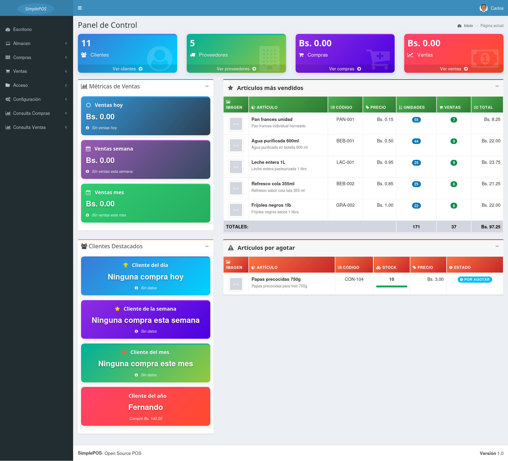
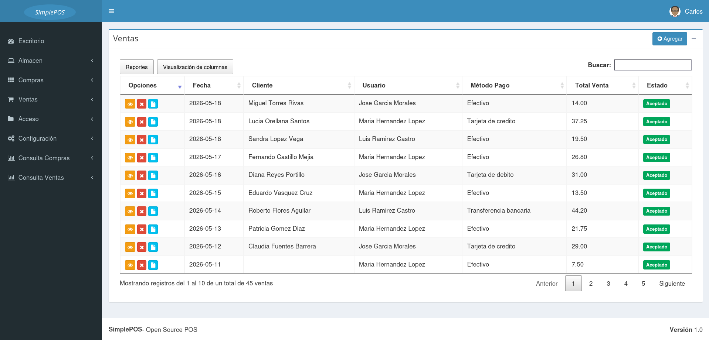
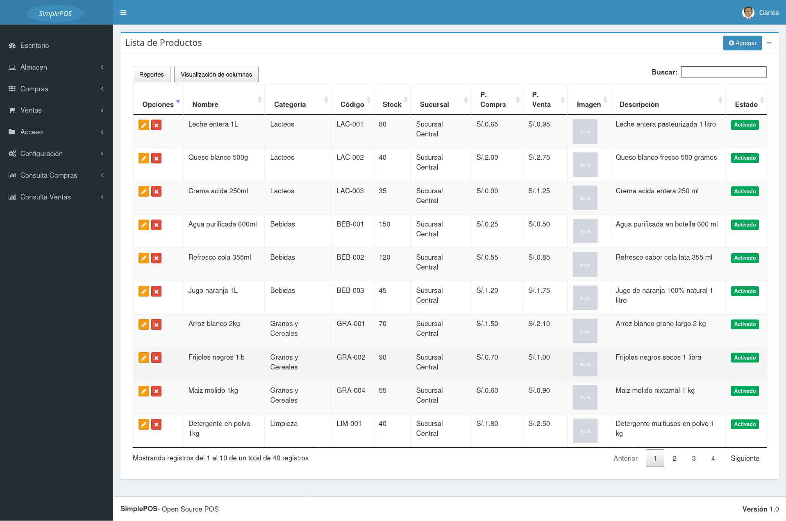
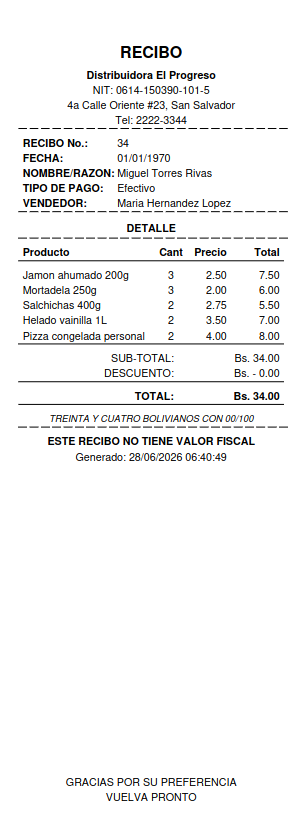

<div align="center">

# SimplePOS

### Sistema de Punto de Venta Open Source

Sistema web de gestión de ventas, compras e inventario para negocios minoristas con soporte multi-sucursal.

[](https://www.php.net/)
[](https://www.mysql.com/)
[](https://getbootstrap.com/)
[](LICENSE)

</div>

---

## Capturas de pantalla

### Dashboard

Panel de control con métricas en tiempo real: ventas del día, semana y mes, mejores clientes y productos más vendidos.



---

### Registro de ventas

Flujo completo de venta: búsqueda de productos, aplicación de descuentos por ítem y selección de múltiples métodos de pago.



---

### Inventario

Listado de artículos por sucursal con indicadores visuales de bajo stock (≤ 10 unidades).



---

### Ticket de venta (PDF)

Comprobante generado automáticamente al cerrar una venta, listo para imprimir o compartir.

<div align="center">
  
</div>

---

## Características

- **Ventas:** Registro con múltiples productos, descuentos por ítem y múltiples métodos de pago por transacción.
- **Compras:** Órdenes de compra a proveedores con actualización automática de stock.
- **Inventario:** Control de stock por sucursal con alertas de bajo stock (≤ 10 unidades).
- **Traspasos:** Transferencia de stock entre sucursales.
- **Clientes y Proveedores:** Administración unificada de personas.
- **Usuarios y Permisos:** Roles con control de acceso por módulo.
- **Reportes PDF:** Ventas por rango de fechas, inventario y tickets de venta.
- **Escritorio analítico:** Métricas en tiempo real (ventas del día/semana/mes, mejores clientes, productos más vendidos).

---

## Tecnologías

| Componente    | Tecnología                     |
| ------------- | ------------------------------ |
| Backend       | PHP 7+ (MySQLi)                |
| Base de datos | MySQL / MariaDB                |
| Frontend      | Bootstrap 3.3.7 + AdminLTE     |
| JavaScript    | jQuery 3, DataTables, Chart.js |
| Reportes PDF  | FPDF 1.81                      |
| Servidor      | Apache (XAMPP / LAMPP)         |

---

## Requisitos

- XAMPP / LAMPP con PHP y MySQL habilitados
- PHP 7.4 o superior
- MySQL 5.7 o superior

---

## Instalación

**1. Clonar el repositorio**

```bash
git clone https://github.com/WorkTeam01/SimplePOS.git /opt/lampp/htdocs/SimplePOS
```

**2. Importar la base de datos**

```bash
mysql -u root -p -e "CREATE DATABASE simplepos CHARACTER SET utf8 COLLATE utf8_general_ci;"
mysql -u root -p simplepos < simplepos.sql
```

**3. Configurar la conexión**

Copiar el archivo de ejemplo y ajustar los valores según tu entorno:

```bash
cp .env.example .env
```

```env
DB_HOST=localhost
DB_NAME=simplepos
DB_USERNAME=root
DB_PASSWORD=
PRO_TIMEZONE=UTC
```

**4. Iniciar el servidor**

```bash
sudo /opt/lampp/lampp start
```

**5. Acceder al sistema**

```
http://localhost/SimplePOS/
```

**Credenciales por defecto:**

| Campo                  | Valor      |
| ---------------------- | ---------- |
| Usuario (N° documento) | `admin`    |
| Contraseña             | `admin123` |

> ⚠️ Cambia la contraseña del admin después del primer inicio de sesión.

---

## Solución de problemas

**La página no carga**
Verifica que LAMPP esté activo: `sudo /opt/lampp/lampp status`. Si Apache o MySQL están detenidos, reinicia con `sudo /opt/lampp/lampp restart`.

**Error de conexión a la base de datos**
Confirma que la base de datos `simplepos` fue importada correctamente y que las credenciales en el archivo `.env` coinciden con tu entorno.

**Imágenes de productos no se muestran**
Verifica que las carpetas `files/productos/` y `files/usuarios/` tengan permisos de escritura: `chmod -R 755 files/`.

---

## Estructura del proyecto

```
SimplePOS/
├── config/          # Configuración de BD y helpers
├── modelos/         # Clases de modelo (lógica de negocio y consultas SQL)
├── ajax/            # Controladores AJAX (punto de entrada de peticiones)
├── vistas/          # Plantillas HTML/PHP
│   └── scripts/     # JavaScript por módulo
├── reportes/        # Generación de reportes PDF (FPDF)
├── fpdf181/         # Librería FPDF
├── public/          # Assets estáticos (CSS, JS, imágenes, plugins)
└── files/           # Archivos subidos por el usuario
    ├── productos/   # Imágenes de productos
    └── usuarios/    # Fotos de perfil
```

---

## Módulos

| Módulo               | Descripción                                |
| -------------------- | ------------------------------------------ |
| Escritorio           | Panel de control con métricas y analíticas |
| Artículos            | Gestión de productos e inventario          |
| Categorías           | Clasificación de productos                 |
| Ventas               | Registro y anulación de ventas             |
| Compras              | Órdenes de compra a proveedores            |
| Traspasos            | Transferencia de stock entre sucursales    |
| Clientes             | Administración de clientes                 |
| Proveedores          | Administración de proveedores              |
| Usuarios             | Gestión de cuentas del sistema             |
| Perfiles y Permisos  | Control de acceso por rol                  |
| Empresa y Sucursales | Configuración del negocio                  |

---

## Contribuir

Las contribuciones son bienvenidas. Para cambios significativos, abre un issue primero para discutir qué te gustaría modificar.

1. Haz fork del repositorio
2. Crea una rama para tu feature (`git checkout -b feature/nueva-funcionalidad`)
3. Haz commit de tus cambios (`git commit -m 'feat: agregar nueva funcionalidad'`)
4. Haz push a la rama (`git push origin feature/nueva-funcionalidad`)
5. Abre un Pull Request

---

## Colaboradores

<table>
  <tr>
    <td align="center">
      <a href="https://github.com/Jandres25">
        <br/>
        <sub><b>Jandres25</b></sub>
      </a>
    </td>
    <td align="center">
      <a href="https://github.com/carlosguerra12">
        <br/>
        <sub><b>carlosguerra12</b></sub>
      </a>
    </td>
  </tr>
</table>

---

## Licencia

<div align="center">

[MIT](LICENSE)

</div>

---

<div align="center">

Hecho con ❤️ por [WorkTeam01](https://github.com/WorkTeam01)

</div>
